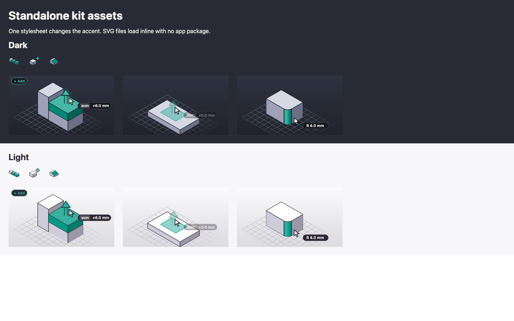
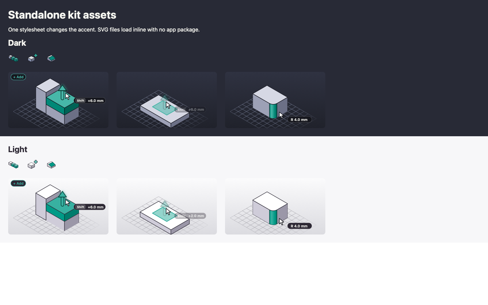

# Standalone icons and tooltip loops

The integrator kit includes `assets/`, usable without React, SlicerX packages, or an app runtime. It contains every registered shaded tool icon in its own 32, 24 and 16 px drawing, the line icon set, and every registered tooltip demo. Both dark and light SVG variants are included. Still diagrams remain still; animated demos retain their CSS and SMIL animation and reduced-motion frame.

Build the full kit as usual, or generate just the assets with Node 24:

```sh
node scripts/pack-integrator-kit.mjs ./slicerx-kit --assets-only
```

Add `--zip-assets` to also write `slicerx-kit-assets-<version>.zip` beside the kit. It holds the contents of `assets/` in one folder, `slicerx-kit-assets-<version>/`, and is listed in `SHA256SUMS.txt`. Two packs of the same commit give the same zip, byte for byte.

`assets/manifest.json` records `kind`, `id`, `settingKey`, `title`, `theme`, `file`, and pixel `size` for each asset. Non-setting assets have `settingKey: null`. A loop shared by several settings has several manifest rows pointing to the same file. Loop titles are the registry's descriptive sentences; icon titles are readable forms of the stable icon ids. The manifest is the authoritative file list when regenerating into an existing folder.

## One stylesheet for colors

Include `assets/tokens.css`, then your overrides. Wrap inline SVGs in a theme container:

```html
<link rel="stylesheet" href="assets/tokens.css">
<style>[data-sx-theme] { --accent: #009b87; }</style>
<div data-sx-theme="dark"><!-- Insert the SVG markup here. --></div>
<div data-sx-theme="light"><!-- Insert the SVG markup here. --></div>
```

The token names are the existing UI contract: `--accent`, `--fg`, `--ink-0`, `--red`, `--cyan`, `--f-body`, `--scene-*`, `--stage-*`, and `--ti-*`. Changing `--accent` on the same theme container changes the derived icon and loop shades. Set individual stage or icon tokens for finer control. No app stylesheet is required.

Every SVG also contains fallback colors, so opening the file by itself works. CSS on a parent HTML page cannot cross into an `` or `<object>` document. Insert SVG markup inline when you want the shared stylesheet to recolor it. Defaults and overrides preserve CSS variables rather than baking a custom palette into thousands of paths.

Exported ids, CSS classes and animation names are prefixed per asset kind, id, theme, and size, allowing different assets and both themes on one page. If inserting the same file more than once, give each copy a unique id prefix and update its `href` and `url(#...)` references, or use separate image documents.

## Loop backdrop and your edition

Tooltip loops are transparent by default, so they sit on whatever your popover, tooltip or viewport draws behind them. `--scene-top` and `--scene-bottom` are left out of `tokens.css` in that case, because nothing reads them.

Each loop's ground is one CSS custom property on its root, `--sx-loop-backdrop`, read as a CSS `background`. Set it on any element around an inline loop to change or remove the ground at runtime, with no new kit:

```css
/* a ground of your own behind every loop in your setting popovers */
.settings-popover { --sx-loop-backdrop: linear-gradient(180deg, #2a2e37, #0a0c10); }
/* no ground at all, even in a kit exported with --backdrop */
.settings-popover { --sx-loop-backdrop: transparent; }
```

Any `background` value works: a color, a gradient or `none`. Unset, the loop uses the default it was exported with. Like the other tokens, it reaches only inline SVG markup; a loop shown through `` keeps its default.

Two options change the export, on either command:

```sh
node scripts/pack-integrator-kit.mjs ./slicerx-kit --assets-only --edition harbor.json
node scripts/export-kit-assets.mjs ./assets --backdrop --edition harbor.json
```

- `--backdrop` makes the studio gradient, from `--scene-top` to `--scene-bottom`, each loop's default ground and keeps those two properties in `tokens.css`. `--sx-loop-backdrop` still overrides it.
- `--edition <file>` reads an edition JSON (the whole file, or just its `brand.theme` block) and uses its accent, visual properties and `scene` colors in `tokens.css` and in each SVG's fallback colors. Values it leaves out stay SlicerX's. Without `--accent`, the palette's `purple` is the accent. A TypeScript config has to be resolved first: `node packages/edition-config/src/cli.ts resolve editions/harbor/edition.config.ts > harbor.json`.

`manifest.json` records both: `loopBackdrop` is `transparent` or `scene`, and `edition` is the edition's id, `custom` for a config without one, or `null`. The scene keys are listed in [Restyle tool icons and tooltip loops](restyle-icons-and-loops.md#studio-colors).

## Plain HTML example

Serve the `assets` folder over HTTP and open `example.html`, for example with `python3 -m http.server` in that folder. Opened straight from the folder (a `file://` address), the page stays blank, because browsers block it from loading the SVG files next to it. It loads three shaded tool icons and three loops in both themes, using `example.css` to change the accent. The only JavaScript fetches trusted local SVG files and inserts their markup. The example does not load any app bundle, framework, font service, or backend.

Clients: the kit packaging command adds `--assets-only`; `node scripts/export-kit-assets.mjs <assets-directory>` is also available. No MCP tool or application command changes.

The example checked in Chromium and WebKit with the custom accent and both themes:




